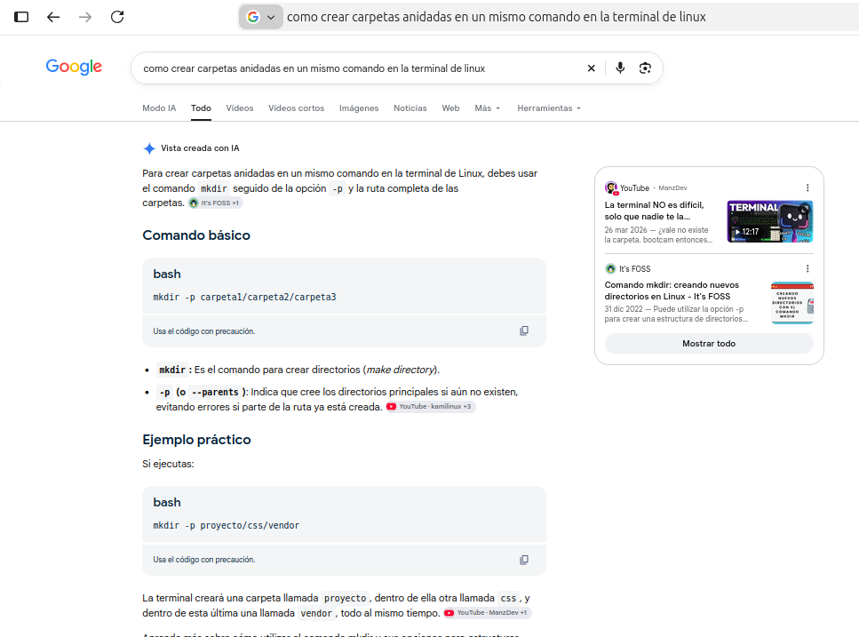
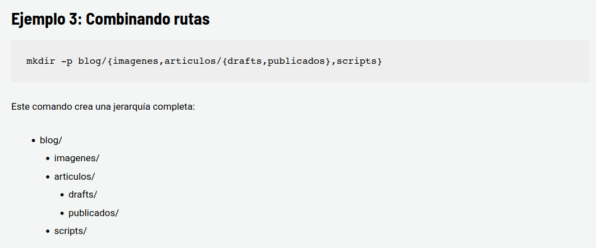
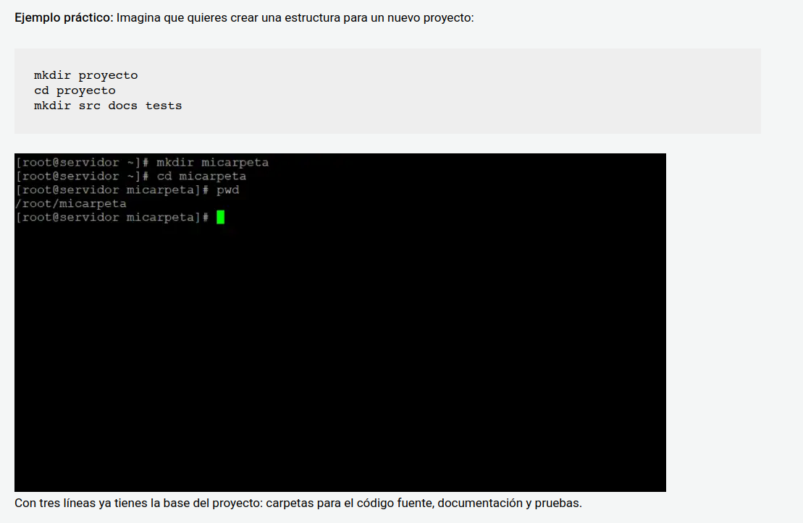
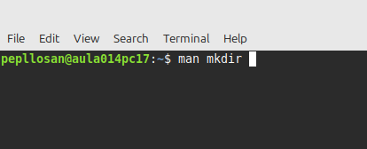
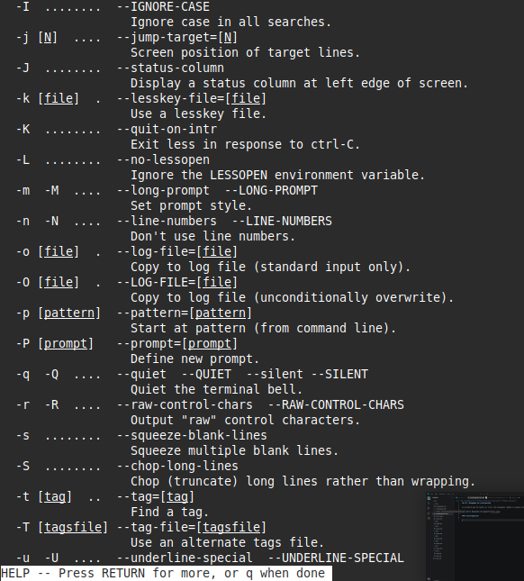
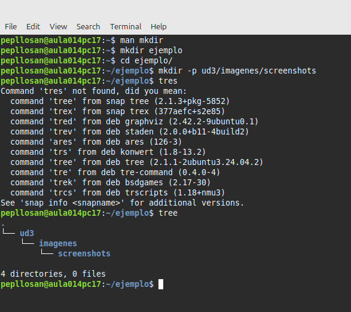
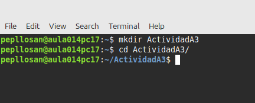
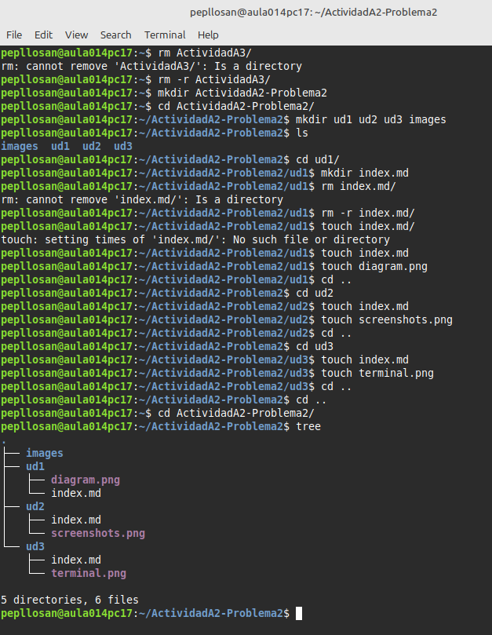
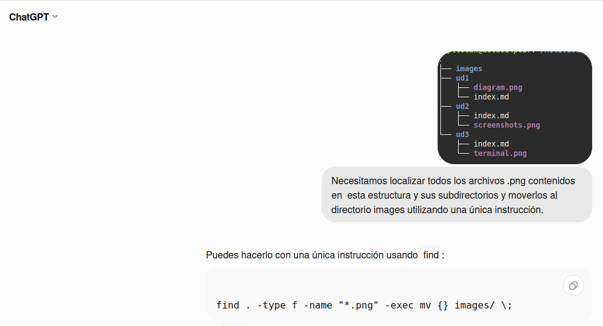
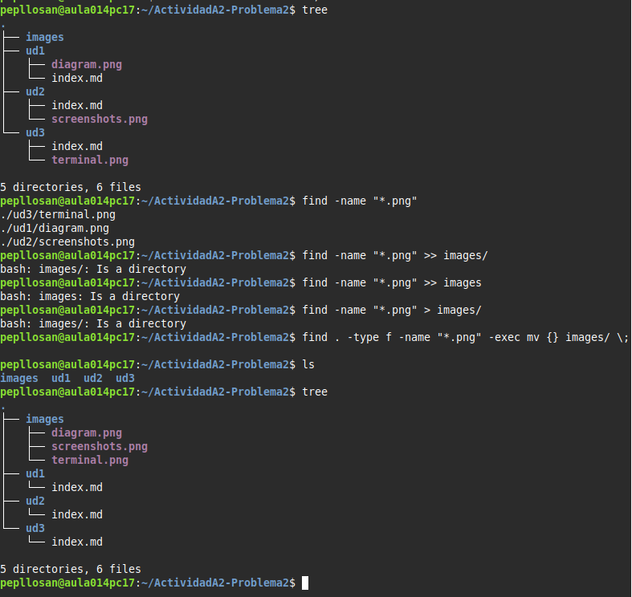

## A2. Búsqueda de información

Lo primero que he hecho es tirar una busqueda rapida en google del problema que quiero solucionar.

## Buscando mas informacion me aparecio lo siguiente 

# Investigacion:

Lo siguiente que he hecho es meterme en la primera pagina recomendada tras la busqueda que era de HostingTG en la que me aparecia la siguiente informacion que me acercaba cada vez mas a la solucion.

# Testeo:

Acontinuacion me he metido en la terminal de linux para contrastarlo con la ayuda que nos da el propio panel de la terminal.

En la ayuda de la terminal acabamos de contrastar la información

## Procedemos a ponerlo en la terminalrrrrr

## A2 PROBLEMA (Opcional)

# A2
> Para empezar me he creado una carpeta en mi usuario para no ensuciar el resto

> A continuacion me he puesto a crear a mano la estructura de directorios ya que no era muy compleja

> A continuacion e ido a chat gpt y le he preguntado utilizando una captura de pantalla que comando puedo utilizar para agrupar todas las imagenes en la carpeta images, y me ha proporcionado la primera pista.

> A continuacion e utilizado el comando que me ha proporcionado chat gpt y tras jugar con el comando find lo he conseguido.

