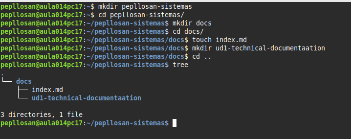
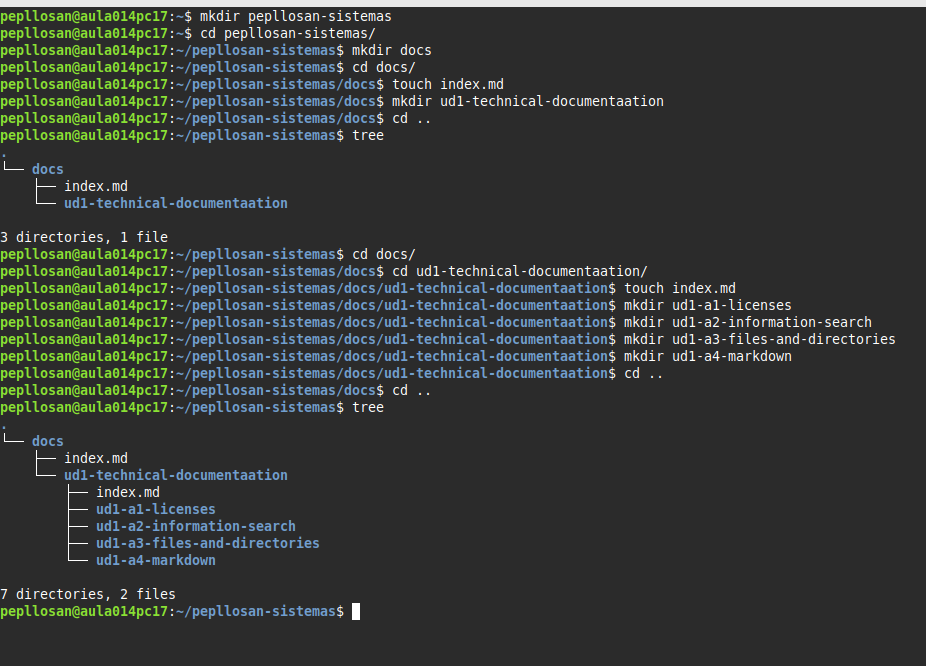
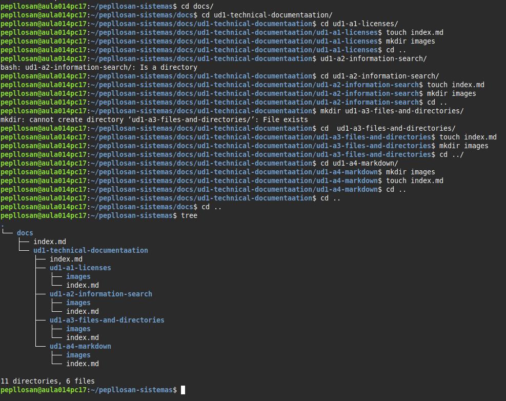
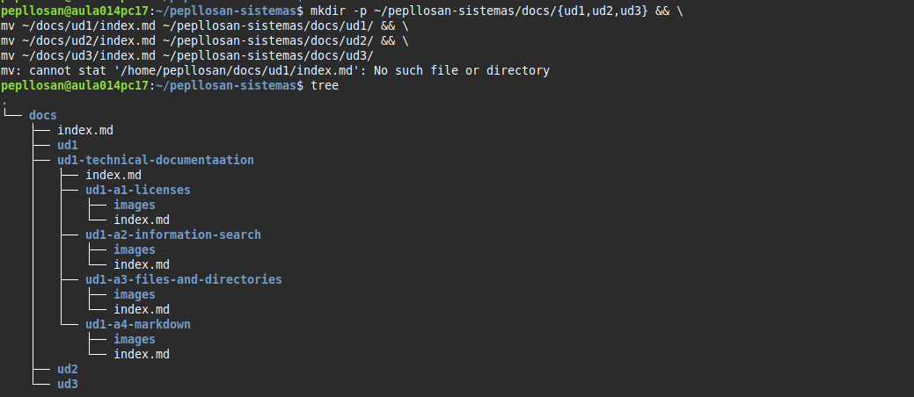

# A3 Archivos y directorios
> E ido creando poco a poco las carpetas de forma organizada 

> E continuado con los siguientes directorios

> Y por ultimo realizamos los index y las carpetas images

> Y por ultimo e echo el ultimo paso que me pide el ejercicio en el que lo he conseguido consultando a chat gpt

