# A5. Git 
 
 ## 1. Comprobar Git 

 > Primero e comprobado el email y el nombre de usuario de git

 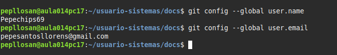

 > A continuacion me he situado donde me pide la actividad

 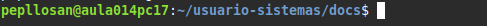

 > A continuacion e iniciado el repositorio con git init

 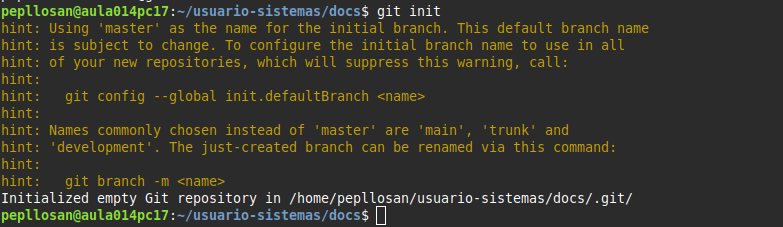
 
 > E tirado un git status y me dice que no tengo creado nada ni commits ni ramas

 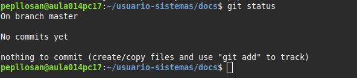

 > En la carpeta donde estoy haciendo la actividad e mostrado los archivos ocultos

 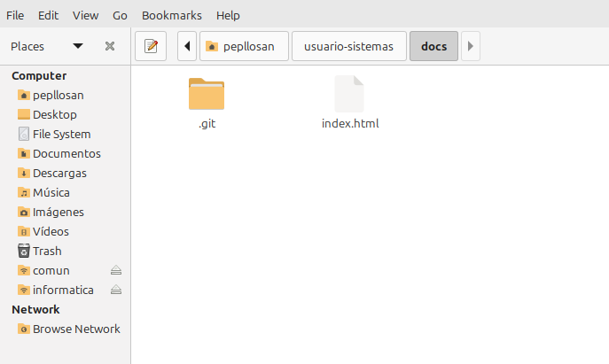

 > E creado un documento index.html y lo he añadido con el comando git add

 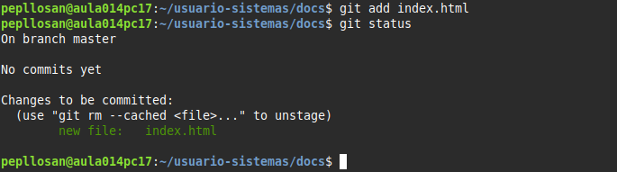

 > E creado el primer commit con el nombre indicado

 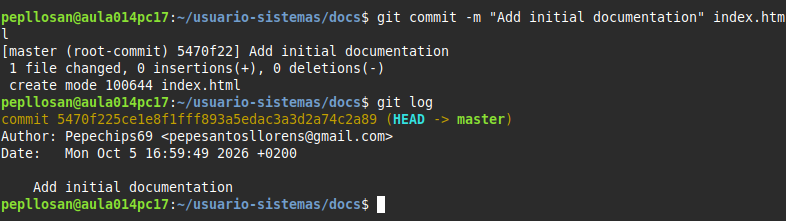

> E modificado el index html y e revisado el estado del repositorio

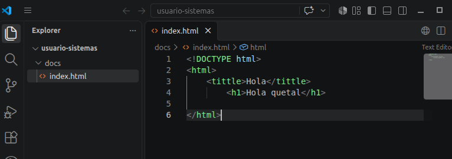
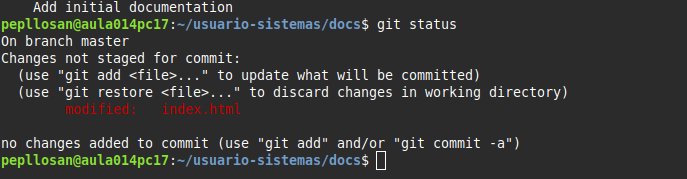

> E comprobado las diferencias desde el ultimo commit

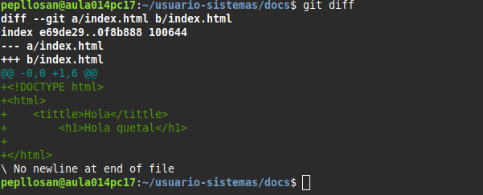

> E creado un nuevo commit con las modificaciones añadidas anteriormente 

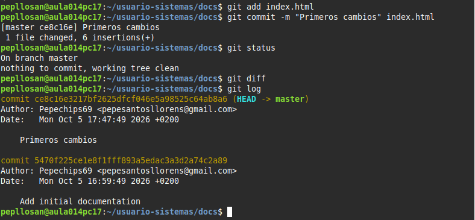

> Estos son los commit que he realizado:

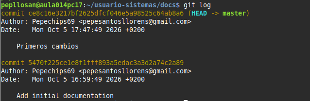