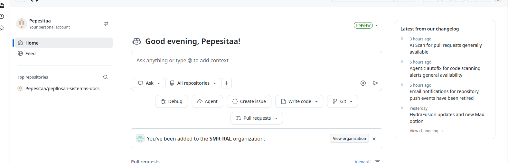
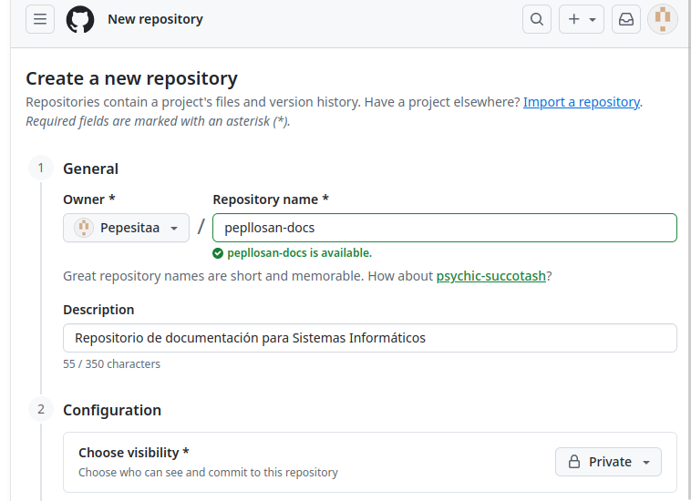
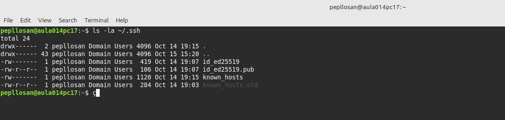
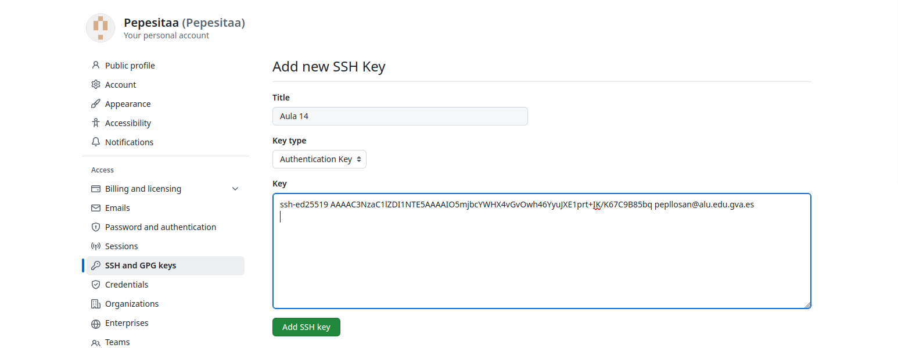
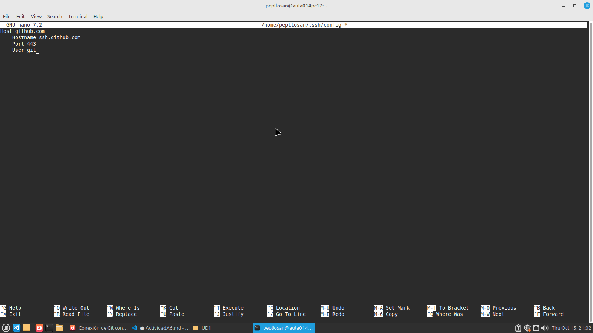
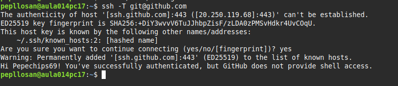

## A6. GitHub 
> Entra en GitHub e inicia sesión con tu cuenta de usuario institucional o personal asociada a tu identidad digital.

> Creo el repositorio dentro de github

> Comprobar claves SSH existentes:
Terminal.Abre tu terminal y ejecuta el siguiente comando para verificar si ya dispones de una clave SSH en tu equipo:

> A continuacion copio la llave

> Y creamos la llave ssh

> Configuramos el puerto 443

> Comprobamos que la conexión SSH se realiza correctamente ejecutando:

> Conecta tu repositorio local con el repositorio remoto en GitHub utilizando la dirección SSH y el nombre origin.
